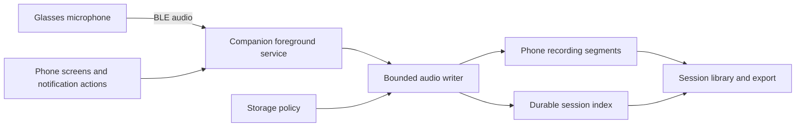

# Independent Glasses Lab companion and extended recording

Implementation checklist: [implementation plan](../plans/2026-10-26-glasses-lab-independent-companion.md).

## Outcome and scope

Glasses Lab becomes Ross's only installed phone companion. The glasses run our
ASG builds. Audio recording has no application-imposed session duration limit,
continues with the phone locked and screen off, and uses a configurable amount
of phone storage. Video follows after audio, with direct recording of a local
glasses stream on the phone as the first architecture to evaluate.

"Our OS build" means the ASG application controlling the glasses on their
existing MTK Android and BES firmware. Bootloader unlocking, partition flashing,
vendor firmware replacement, and firmware OTA are outside this work. Retain the
disabled stock glasses packages, their data, and PC recovery artifacts. The
official phone app is removed after export and replacement validation.

This document describes the intended design. Implementation began October 26,
2026; the linked plan records actual changes, measurements, and remaining gates.
The official phone app was uninstalled on October 27. Shared phone-media storage,
automatic verified offload, and UI/shortcut improvements are being validated in
0.4; the linked plan records exact build and hardware evidence.

## Baseline and known gaps

The following is the pre-implementation baseline. See the linked plan for the
current build, completed extended-audio test, and remaining acceptance checks.

- Phone: Samsung Galaxy A14 5G / Android 15; companion targets API 35.
- Glasses: Android 11/API 30, locked bootloader, vendor firmware retained.
- Packages: `dev.ross.glasses` on phone; `com.mentra.asg_client.thirdparty` on glasses.
- No Mentra account is required by the current companion. SDK analytics are disabled.
- Existing short audio, glasses-side video-with-sound, photo, and two-way call tests
  succeeded. Long screen-off recording and the final phone video-download build
  have not passed device acceptance yet. Recheck device state before deployment.
- Audio has a 30-minute controller/size limit. The recording service has a
  35-minute wake-lock timeout and stops recording on task removal. It currently
  displays notifications while an application singleton owns the actual work.
- Video requests five-minute clips; the downloader caps files at 1 GiB and
  requires recording to be idle. ASG's file recorder independently caps duration
  at 30 minutes and preserves storage headroom.
- Mentra App gallery v3 transfers completed files in resumable 16 MiB chunks.
  Its acknowledgment moves sources to recoverable trash; current server cleanup
  enforces at least seven days. That does not promptly reclaim recording space.

## Product decisions

| Area | Initial decision |
|---|---|
| Accounts/network | Local operation without Mentra login or cloud dependency |
| Background operation | User-enabled companion connection; recording owned by a foreground service |
| Duration | No session timer or fixed total recording byte ceiling |
| Storage allowance | Optional total recording budget; unset means available space minus reserve |
| Free-space reserve | Proposed default 1 GiB, configurable with a small enforced finalization margin |
| Full storage | Finalize and stop with a clear notification; never silently erase older recordings |
| Audio format | Existing 16 kHz mono PCM/WAV first; optional compression is later work |
| Audio files | Five-minute internal segments, shown as one recording session |
| Calls | Calls take priority; finalize/pause recording and require explicit Resume initially |
| BLE interruptions | Preserve received audio, record a gap, reconnect the selected glasses |
| Explicit stop/reboot | Respect Stop/force-stop; reconnect after reboot but do not silently start recording |
| Video direction | Evaluate local Wi-Fi stream to phone before building continuous local-clip offload |
| Glasses storage | No permanent duplicate for streaming mode; bounded local buffering is a later option |

The storage budget includes committed recordings, active segments, interrupted
files, and recording-related temporary files. Other apps consuming space must
also reduce the available allowance. Export/remux operations require their own
headroom. Photos affect filesystem free space but are not charged to the
recording-specific budget. Quota changes apply without deleting existing data.

Unlimited duration does not imply recording through unavailable microphones,
exhausted batteries, thermal shutdown, disconnection, or an explicit Android
stop. Such events must produce saved media and an honest interruption status.

## Phone architecture

One started/bound `CompanionService` owns the SDK connection, recording controller,
call observation, reconnect jobs, and active writers. Screens observe state and
send commands; closing a screen or swiping away its task does not stop a session.
Use the existing `connectedDevice` foreground-service type for the actual
external-device interaction. Do not introduce a `dataSync` service for ongoing
capture: Android 15 limits that type to six background hours per 24-hour period.
See [Android service types](https://developer.android.com/develop/background-work/services/fgs/service-types#connected-device)
and [service timeouts](https://developer.android.com/develop/background-work/services/fgs/timeout).

Use CompanionDeviceManager association/presence where supported for background
connection recovery, retaining explicit device selection and the SDK's GATT
connection. Association does not establish that connection itself. Launch
foreground work through permitted user/companion entry points and handle denied
starts visibly. See [background BLE](https://developer.android.com/develop/connectivity/bluetooth/ble/background)
and [companion pairing](https://developer.android.com/develop/connectivity/bluetooth/companion-device-pairing).

A partial wake lock belongs to active capture/required finalization, with explicit
release on every exit and bounded renewal while work is healthy. Idle companion
connection must not hold it indefinitely. Doze and Samsung power management need
real-device tests; a notification alone is not a guarantee. Provide a concise
setup/status screen for permissions and any battery setting proven necessary.
See [wake-lock practices](https://developer.android.com/develop/background-work/background-tasks/awake/wakelock/best-practices)
and [Doze](https://developer.android.com/training/monitoring-device-state/doze-standby).

Foreground-service task-manager Stop can kill the process without a cleanup
callback. Recovery must work from disk, and must not restart recording against
that action. See [Android user-initiated stopping](https://developer.android.com/develop/background-work/services/fgs/handle-user-stopping).

## Audio persistence and recovery

- Keep the microphone subscription running across segment boundaries. Rotate
  files in the ordered writer, without toggling the glasses microphone.
- Bound queued PCM. A storage stall must report interruption rather than silently
  discard audio or grow memory without limit.
- Maintain a transactional session index: session/device identity, format,
  ordered segment IDs, sample counts, timestamps, paths, states, and gap reasons.
  Use SQLite transactions; the initial implementation uses `SQLiteOpenHelper`
  with WAL (see the plan's implementation decision). Media bytes remain ordinary private files.
- Write to `.part`, checkpoint data off the UI thread, finalize the WAV header,
  sync, rename, then commit the playable segment to the index. Reconcile every
  crash window, including a renamed file whose index commit did not finish.
- Target checkpoints every five seconds initially; measure their overhead and
  actual loss boundary. File writes alone are not a power-loss durability promise.
- Calculate captured duration from samples. Preserve a separate elapsed timeline
  so calls and missing audio do not appear as continuous recorded sound.
- Recover complete PCM samples from our interrupted segments; quarantine invalid
  files with an explanation. Migrate existing flat WAV/MP4 files without rewriting
  or deleting originals before successful indexing.
- Display one session with duration, size, interruptions, playback, export, and
  explicit deletion. Internally segmented recording must not impose a WAV/RIFF
  single-file size limit on session duration. Large exports can remain a bundle
  of segments; do not promise an arbitrarily large conventional WAV.

At the current format, audio uses about 115 MB/hour. Compression may reduce that
later, but storage reliability and screen-off behavior come first. The phone's
own microphone must remain unused. Existing media/call Bluetooth profiles and
their volume controls must continue to work; simultaneous media playback and
glasses mic delivery requires measurement because current firmware can interrupt
that microphone stream.

## Video design and decision gate

Preferred candidate: ASG encodes video and audio once, transmits them over local
Wi-Fi, and the phone saves encoded media without decoding/re-encoding it. Preview
is optional and off by default. The same phone storage policy and session index
serve audio and video.

Prototype SRT using the existing publisher first, with RTMP as the fallback
comparison. Select the receiver library only after checking Android/ARM support,
license, packaging, recoverable recording, and network binding. WHIP/WebRTC is
not required for the first recorder; low-latency interactive preview is not the
primary requirement. Record the transport choice and measured reasons.

Start with the glasses' local-only hotspot and a phone receiver on that network.
Discover fresh credentials and addresses per connection; retain cellular routing
for other phone traffic. Authenticate the recording session using credentials
exchanged over the paired control link and bind the receiver to the intended
interface. Test reverse reachability from glasses to phone before treating this
topology as viable. A shared Wi-Fi network is a diagnostic fallback, not a
requirement for normal use away from home.

Two existing ASG paths need explicit review: `StreamCommandHandler` currently
checks connected Wi-Fi, and hotspot inactivity observes HTTP traffic. Local AP
streaming must pass a real reachability/readiness check and hold a session-scoped
hotspot lease driven by stream progress. Neither blindly bypass the Wi-Fi check
nor disable inactivity cleanup globally. Release leases after stop, error, or
expired receiver/stream heartbeat.

Use recoverable staging such as supported fragmented MP4 or MPEG-TS and short,
keyframe-aligned segments. Ordinary MP4 finalization must not be assumed crash
recoverable. Preserve original audio/video timestamps, start segments with needed
codec configuration/keyframes, and mark reconnect discontinuities. Phone process
death, receiver disk failure, and loss of the control link must stop the camera
through a bounded glasses-side watchdog. Keep indicators and resource cleanup.

Streaming avoids gallery trash for the primary path, but does not preserve media
that never reaches the phone. If testing shows unacceptable outages, add a
bounded glasses spool from the same encoded stream. Purge only exact, finalized,
generation-matched segments after durable, verified phone receipt. Never overwrite
unacknowledged footage; stop when that spool fills. Physical free space must
actually increase after purge. Do not route this spool through seven-day trash.

Retain ordinary gallery recovery for existing/offline captures. Introduce any
early purge as an explicit, authenticated, fork-only capability scoped to our
media namespace and verified capture IDs. Keep stock media, storage reserves,
and legacy gallery behavior outside that operation.

## Acceptance boundaries

Daily use must work without the Mentra App installed or Mentra cloud available:
connect/reconnect, status, photos, audio, library/export, hardware-button behavior,
phone media, calls, and volumes. Verify cold boot of the custom ASG as well as
phone unlock/reconnect; `--keep-running` is not evidence of reboot reliability.

Audio acceptance includes screen-off/unplugged phone runs beyond 35 minutes,
multi-hour recording, segment continuity, storage exhaustion, calls, BLE loss,
task removal, process death, and recovery. Aim for an eight-hour endurance run
where glasses power and temperature permit; report the actual hardware duration
separately from simulated long-run storage tests.

Video acceptance must establish sustained recording, A/V sync, interruption
recovery, bounded memory/storage, cellular/call coexistence, and temperature and
battery measurements before it becomes the default. Streaming is a candidate,
not yet a proven power or reliability improvement.

## Repository references

- [Current companion behavior and validation](../../../companion_android/README.md)
- [Build/deploy/recovery workflow](../../../README.personal-dev.md)
- [Recorder miniapp](../../../miniapps/recorder/src/background/controllers/RecorderController.ts)
- [Gallery transfer implementation](../../../mobile/modules/engine/src/services/asg/asgCameraApi.ts)
- [Gallery commit and acknowledgment](../../../mobile/modules/engine/src/services/asg/mediaProcessingQueue.ts)
- [Streaming command handler](../../../asg_client/app/src/main/java/com/mentra/asg_client/service/core/handlers/StreamCommandHandler.java)
- [Hotspot lifecycle](../../../asg_client/app/src/main/java/com/mentra/asg_client/io/network/core/BaseNetworkManager.java)
- [Standing glasses platform specification](../../../asg_client/docs/mentra-live-spec.md)
