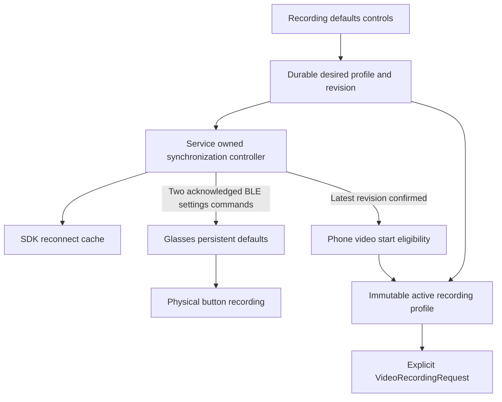

# Glasses Lab shared video recording defaults

Add a **Recording defaults** section to Glasses Lab settings. A user selects one
video profile, and that profile configures recordings started from the phone,
notification, tile, launcher shortcut, or glasses camera button. The glasses
retain their applied defaults for use without the phone.

Implementation checklist: [recording defaults plan](../plans/2026-10-27-glasses-lab-recording-defaults.md).
The companion [camera defaults design](2026-10-27-glasses-lab-camera-defaults-design.md)
adds still-photo size and shares the synchronization lifecycle. Use one
`CaptureDefaultsSyncController` with separate photo/video revisions and status;
neither domain's pending settings block the other's capture controls.
This extends the existing [independent companion design](2026-10-26-glasses-lab-independent-companion-design.md)
for the current glasses-side MP4 recorder. Continuous video streaming remains a
separate project.

## Controls and initial values

Place the section near the top of `RecordingSettingsActivity`, before the storage
allowance controls. Keep the existing storage, media Wi-Fi, background, and
temporary-file settings available.

| Control | Choices | Initial value |
|---|---|---|
| Resolution | 720p (1280 × 720), 1080p (1920 × 1080) | 720p |
| Frame rate | 5, 15, 30 FPS | 30 FPS |
| Maximum video length | 3, 5, 10, 15, 20 minutes | 5 minutes |

Use labeled native selection controls and a **Save recording defaults** button.
Explain: "Used when recording from this phone or the glasses button. Changes
apply to the next video." Lower FPS produces less smooth motion. Maximum length
is an upper limit; battery, storage, or capture errors can end a clip earlier.

The FPS choices have historical recording evidence at both resolutions in the
[FPS measurements](../../../asg_client/docs/fps-thermal-test/data/SUMMARY.md).
Recheck them on the current phone/glasses build before release. Those historical
notes contain an obsolete description of the resolution validator; current
[`VideoSettings`](../../../asg_client/app/src/main/java/com/mentra/asg_client/settings/VideoSettings.java)
allows only 720p and 1080p. Its numeric allowance of up to 60 FPS does not establish
60 FPS hardware support. Lower FPS also does not imply smaller files: the current
encoder bitrate is selected by resolution.

Video continues to include microphone audio and recording cues. The existing
`sound` request field controls cues, and the physical-button path hardcodes cues
on. Adding a shared cue toggle would require a new persisted glasses setting and
SDK/protocol support. `save` is webhook-upload retention, not the phone-library
preference. Neither field becomes a control in this iteration. Capture indicators,
audio-only recording, and verified media offload keep their existing behavior.

## Current implementation boundaries

The October 27 source baseline is Glasses Lab `0.4.0-dev`, using the shared native
Android Bluetooth SDK and the custom ASG package. Relevant behavior is:

| Component | Current behavior and consequence |
|---|---|
| [`RecordingController.startVideo`](../../../companion_android/app/src/main/java/dev/ross/glasses/RecordingController.kt) | Explicitly requests 720p/30 FPS/five minutes. Only `active_video` is persisted for recovery; the profile must be added. |
| [`RecordingSettings`](../../../companion_android/app/src/main/java/dev/ross/glasses/RecordingSettings.kt) | Stores storage policy and keep-ready media Wi-Fi preferences, but no video profile. |
| [`MentraBluetoothSdk`](../../../mobile/modules/bluetooth-sdk/android/src/main/java/com/mentra/bluetoothsdk/MentraBluetoothSdk.kt) | Separate acknowledged setters exist for resolution/FPS and duration. Each updates the SDK cache after its acknowledgement. |
| [`DeviceStore`](../../../mobile/modules/bluetooth-sdk/android/src/main/java/com/mentra/bluetoothsdk/DeviceStore.kt) | Process-local settings begin with 720p/30 FPS and ten minutes. The cache is not a durable user-preference store. |
| [`MentraLive`](../../../mobile/modules/bluetooth-sdk/android/src/main/java/com/mentra/bluetoothsdk/sgcs/MentraLive.kt) | Replays cached settings during `glasses_ready`. ASG process restarts can repeat readiness without changing the public `ready` Boolean. |
| [`AsgSettings`](../../../asg_client/app/src/main/java/com/mentra/asg_client/settings/AsgSettings.java) | Persists button defaults. Only 3/5/10/15/20 minutes are accepted; other values normalize to ten minutes. |
| [`SettingsCommandHandler`](../../../asg_client/app/src/main/java/com/mentra/asg_client/service/core/handlers/SettingsCommandHandler.java) | Acknowledges the supplied duration, even when persistence normalized it. Restricting this UI to the accepted duration set avoids that mismatch. |
| [`ButtonEventSubscriber`](../../../asg_client/app/src/main/java/com/mentra/asg_client/service/core/handlers/subscribers/ButtonEventSubscriber.java) | Already reads saved resolution/FPS/duration for each local button-started video. Gallery-mode gating still applies. |

Phone requests must explicitly carry the profile. An omitted duration currently
means no requested timer. An entirely omitted resolution/FPS object can reach
the recorder's built-in defaults instead of the saved glasses profile.

## Profile ownership and persistence

Use one app-wide `VideoRecordingProfile(width, height, fps, maxMinutes)` for the
currently selected glasses. Selecting another device applies the same user
profile; confirmation is always associated with the actual device and connection
session. Separate per-device preference editors are outside this iteration.

Persist the complete validated profile, schema version, and monotonically
increasing revision in a dedicated preference namespace through `RecordingSettings`.
A failed local save leaves the previous profile active and produces a visible
error. Old installations without this namespace initialize to the existing phone
profile, 720p/30 FPS/five minutes. This intentionally changes the previously
independent glasses duration to five minutes after successful synchronization.

Keep three distinct values:

- **Desired profile:** the latest successfully saved user choice.
- **Applied profile:** the exact revision acknowledged for the current device and
  connection generation. An SDK cache value alone is not confirmation.
- **Active profile:** the immutable snapshot used to start an individual video.

Before sending a start command, persist the active profile and recording ID in
one preferences edit. Recovery must retain both. A legacy entry containing only
the ID remains stoppable, but displays an unspecified duration rather than taking
the user's newly selected duration as the old recording's limit.

## Synchronization and readiness

`GlassesController`, owned by `CompanionService`, owns a small synchronization
controller. Activities display its state and submit saves; changing screens or
rotating the phone must not cancel synchronization.

Add a narrow, typed SDK method to populate its recording-default cache without
sending BLE or claiming application. Seed it from the durable profile after SDK
creation and before selecting/connecting the saved device. It writes the canonical
`button_video_settings` object, legacy width/height/FPS keys, and duration together
as one serialized operation. The SDK's automatic replay must use these values
rather than process startup defaults.

For each saved revision, call `setVideoRecordingDefaults` and
`setMaxVideoRecordingDuration` sequentially. Validate acknowledgement setting,
status, and returned values; SDK correlation handles request IDs. Mark the whole
profile applied only after both commands succeed for the latest revision and
current connection generation. A partial failure remains pending and is retryable.

Serialize synchronization attempts. If the user saves B while A is in flight,
retain B durably, finish or invalidate A, and then apply B. A late A acknowledgement
must not mark B applied or leave A in the reconnect cache. Reconcile the cache to
the latest desired profile before the worker becomes idle.

Disconnect, device replacement, or `glasses_session_changed` invalidates current
confirmation. The existing raw event callback can receive the session-change
signal. Add a raw readiness-completion signal from `MentraLive` after its automatic
settings replay has been queued; this lets the companion reapply with
acknowledgements after a same-link ASG restart. That signal means readiness replay
was queued, not that settings were accepted. Coalesce it with ordinary ready
transitions so one connection does not create duplicate workers.

Use bounded retries for transient failures while connected, followed by an
explicit **Retry applying** action. Retain pending preferences through disconnect
and app restart. Never reconnect solely because a settings retry fired after the
user chose Disconnect. Hold any service work/wake lock only for the bounded active
attempt, not for offline pending state.

### Application boundary

Resolution/FPS and duration are separate writes in the existing protocol. A
physical press during application or after a partial failure can use old or mixed
values. The promise that both triggers use the selected complete profile begins
after both acknowledgements. Offline glasses use whichever values they last
received. The UI must not promise that failed application rolled everything back.

A guarantee that physical presses never observe a mixed profile would require a
combined atomic settings command and ASG changes. That protocol expansion is not
part of this plan. Existing ASG setters also do not propagate a failed
`SharedPreferences.commit()` result; the applied status represents the current
protocol acknowledgement, with reboot persistence covered by device acceptance.

## Recording and UI behavior

Phone video starts require normal capture eligibility plus confirmation of the
current profile. A tap while defaults are pending reports that they are still
being applied; it does not queue a recording for later or silently use another
profile. Photo/audio eligibility remains independent. Stop remains usable even
when synchronization is failing, and recovering an uncertain recording takes
priority over starting anything new.

Apply this video-specific eligibility to the main Video button, notification
action, launcher shortcut, and Quick Settings tile. The existing shared
`canRecord` and tile `ready` fields cover audio too, so they cannot be changed to
block all controls whenever video defaults are pending.

Saving defaults while a recording is active may update stored glasses preferences
for the next recording. It must never restart/reconfigure the current recorder or
replace its active profile. Both physical and phone recording paths already take
their capture settings at start. Remove fixed five-minute copy from recording,
disconnect, idle, and recovery messages in favor of the appropriate desired or
active profile.

| State | Settings feedback |
|---|---|
| Saved offline | Saved on phone. Connect glasses to apply. |
| Applying | Applying recording defaults to glasses… |
| Both commands confirmed | Applied to glasses. |
| Timeout or partial failure | Saved on phone. Could not finish applying to glasses. Retry applying. |
| Active recording after a new save | Current video keeps its original settings. New defaults apply to the next video. |

Keep editable selections separate from service updates so status refreshes do not
discard unsaved edits. Preserve selections across rotation, subscribe/unsubscribe
with `CompanionActivity` binding, and keep SDK work out of Activity scopes.

## Acceptance

The implementation is complete when every offered profile can be saved and used
by both triggers, synchronization failures are represented honestly, reconnects
and process restarts preserve the intended profile, and active recordings retain
their own configuration and Stop behavior. The implementation plan specifies unit,
UI, build, and physical-device checks. Changes to media Wi-Fi approvals, offload,
audio duration, firmware, or cloud services are not needed for this feature.
